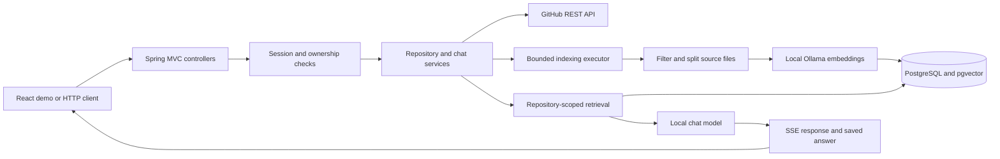
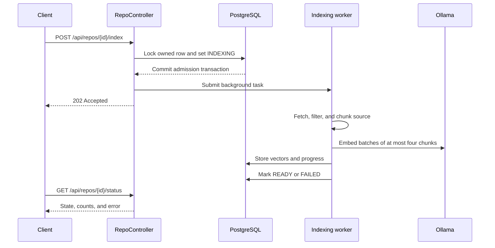

# Architecture

CogniStream is a layered Spring Boot service with a small React demo client. PostgreSQL stores users, repositories, chat sessions, messages, and vector embeddings. Business rules and access control belong to the backend.

## Authentication

GitHub OAuth creates the authenticated session. `GithubOAuth2UserService` maps the GitHub profile, and `UserService` saves it with an encrypted access token. Repository and chat operations check ownership against the signed-in user.

## Repository indexing

`RepoService` syncs repository metadata. `IndexingService` runs in the background and reads files from the default branch. `CodeFileFilter` excludes generated files, unsupported formats, and files larger than 100 KiB. `CodeChunker` splits eligible files into token-based chunks.

`startIndexing` acquires a pessimistic write lock on the owned repository in a short transaction. It rejects an already-running index, resets progress, and commits before submitting the external work. This prevents two competing requests from admitting duplicate jobs. Executor rejection marks the job FAILED and returns 503 so it can be retried.

Ollama generates embeddings locally with `nomic-embed-text:latest`, which are stored in pgvector with repository and file metadata. Embedding requests contain at most four chunks to limit CPU and memory pressure. Indexing progress is saved as the job runs. Empty or truncated trees and embedding errors produce a failed job that can be retried.

## Chat

`CodeContextRetriever` selects the eight closest code chunks, filtered by repository ID. `ChatPromptBuilder` combines that context with the current question. `qwen2.5-coder:1.5b` generates answers locally through Ollama. `ChatStreamHandler` sends the response through server-sent events and saves the completed answer with source citations.

The frontend parses the stream, renders Markdown, and links citations to GitHub files. Previous messages are saved for display; they are not included in the model context for a new question.

## Configuration

The backend reads the root `.env` for database credentials, GitHub OAuth, Ollama, and token encryption. The browser receives only the public backend URL. Docker Compose runs PostgreSQL with pgvector, while GitHub Actions runs the backend and frontend checks.

## Persistence

| Table | Responsibility |
|---|---|
| `users` | GitHub identity and encrypted access token |
| `repositories` | Per-user workspace entries, branch, index state, counts, and errors |
| `chat_sessions` | User/repository conversation identity |
| `chat_messages` | User and assistant text with serialized citations |
| `code_vectors_nomic` | 768-dimensional vectors, chunk text, and repository/file metadata |

Ownership is checked by services before repository and conversation operations. Vector searches additionally filter on the authorized repository ID. Lifecycle relationships are currently enforced through service checks rather than a complete database foreign-key model. See [design decisions](BACKEND-DESIGN.md) for trade-offs and current limits.
