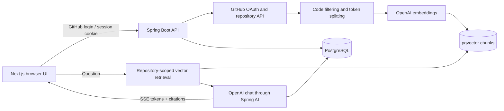

# How the project works

The implementation follows the video and the instructor's DevPilot repository. Package names and UI branding are adapted to CogniStream AI. The original UI structure and feature scope are retained.

Source links are listed in [acknowledgements](CREDITS.md).

## Component responsibilities

`GithubOAuth2UserService` maps a GitHub user into `UserService`. The service upserts the profile and encrypts the access token. `AppUserPrincipal` and `CurrentUser` enforce the authenticated identity.

`RepoService` synchronizes repository metadata and checks ownership. `IndexingService` runs on a separate executor, filters GitHub files, asks `CodeChunker` for token-based chunks, stores embeddings, and persists progress. `CodeContextRetriever` filters similarity search by repository ID.

`ChatService` persists the question, retrieves code context, builds the prompts, and starts `ChatStreamHandler`. The handler streams tokens, persists the complete answer, and emits file citations. The frontend displays saved sessions and live Markdown.

## Corrections made while adapting the tutorial

- Added complete environment-variable configuration, session cookie settings, CORS origins, and credential setup instructions.
- Kept the user's Java 21 package and fixed the local timezone issue in Maven's run options.
- Read code from the selected default branch and cloned the REST client builder so authorization headers do not accumulate across users.
- Propagated embedding failures into FAILED status; rejected empty and truncated trees instead of falsely reporting READY.
- Encoded token events explicitly as JSON strings; the browser also accepts CRLF-delimited SSE and handles error events.
- Disposed streaming subscriptions on timeout/disconnect and moved persistence off the provider's reactive event loop.
- Added automated checks with isolated test doubles. Live credentials are not substituted with mock product behavior.
- Used a new pgvector container/volume on port 5433, preserving the earlier database configuration in a local backup when applying changes.

## What to explain during submission

RAG uses retrieved repository chunks rather than sending every file with every question. Embeddings make semantically similar chunks searchable. The repository metadata filter prevents unrelated indexed repositories from becoming question context. SSE makes the response appear incrementally, and citations let the user inspect the retrieved files. Token encryption protects the stored GitHub token; API responses omit it.
